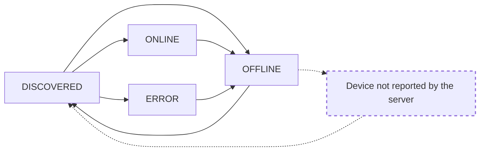

# Device Discovery Lifecycle

## Introduction

The System API Server actively establishes and monitors the connection states of each device available on the network and reports discovery state for each device as it transitions through different phases of the discovery process. This guide will focus on explaining the following:

1. Getting discovery state information of devices
2. Subscribing to device state information of devices
3. Device discovery states and their significance
4. Possible device discovery state transitions

## Getting Discovery State Information of Devices

To see the discovery state information for all Shure devices discovered on your network, call the [`GET /v1/devices`](https://shure.stoplight.io/docs/shure-system-api-specification/b3A6MjIxNDMyOTY-get-device-properties-all-devices) endpoint.

```json http
{
  "method": "GET",
  "baseUrl": "https://127.0.0.1:10000",
  "url": "/api/v1/devices"
  "headers": {
    "x-api-key": "",
    "Content-Type": "application/json"
  }
}
```

Here is an example of what the response may look like for a device in the `ONLINE` state. The discovery state of the device is indicated by `deviceState` field of the response as shown below.

```json
[
  {
    "compatibility": "COMPATIBLE_LATEST",
    "deviceState": "ONLINE",
    "hardwareIdentity": {
      "deviceId": "DDFF8B8D-0000-11DD-A000-000EDDCCCCCC",
      "serialNumber": "2TJ06681671"
    },
    "softwareIdentity": {
      "firmwareVersion": "6.0.24",
      "model": "MXA710",
      "firmwareValid": true
    },
    "communicationProtocol": {
      "name": "ESTA.DMP",
      "address": "169.123.1.12"
    },
    "capabilities": [
      "audio-mute",
      "audio-network",
      "control-network",
      "name",
      "user-presets",
      ...
    ]
  }
]
```

## Subscribing to Discovery State Information of Devices

In addition to being able to get a moment-in-time snapshot of the device discovery state for each device, it is also possible to subscribe to all device discovery state changes using the [`POST /v1/devices/subscription/{transportId}`](https://shure.stoplight.io/docs/shure-system-api-specification/b3A6MjcwMDg4MDM-subscribe-device-state) endpoint.

```json http
{
  "method": "POST",
  "baseUrl": "https://127.0.0.1:10000",
  "url": "/api/v1/devices/subscription/{transportId}"
  "headers": {
    "x-api-key": "",
    "Content-Type": "application/json"
  }
}
```

Refer to the instructions posted in ['Subscribe to Data' Section on the 'Getting Started' Guide](../docs/Getting-Started.md#subscribe-to-data) to learn how to use subscription endpoint to subscribe to data using WebSockets.

Here is an example of how the device discovery state change event may look like for a device in the `DISCOVERED` state once subscription has been made using the endpoint mentioned above.

```json
{
  "envelope": {
    "eventName": "DEVICE_STATE_CHANGE"
  },
  "body": {
    "compatibility": "COMPATIBLE_LATEST",
    "deviceState": "DISCOVERED",
    "hardwareIdentity": {
      "deviceId": "DDFF8B8D-0000-11DD-A000-000EDDCCCCCC"
    },
    "softwareIdentity": {
      "model": "MXA710"
    },
    "communicationProtocol": {
      "name": "ESTA.DMP",
      "address": "169.123.1.12"
    },
    "capabilities": []
  }
}
```

## Device Discovery States and Their Significance

The System API Server reports all devices as being in one of the following four possible discovery states at any given time. The following table provides detailed information about each device state along with the operations which are supported for devices in each of those states.

| Device State | What It Means                                                                                                                                                                                                                                                                                        | Supported Operations                                                                                                                                                                                                                                                     |
| ------------ | ---------------------------------------------------------------------------------------------------------------------------------------------------------------------------------------------------------------------------------------------------------------------------------------------------- | ------------------------------------------------------------------------------------------------------------------------------------------------------------------------------------------------------------------------------------------------------------------------ |
| `DISCOVERED` | This state indicates that a device was found on the network and the server is in the process of attempting to establish a connection with the device. At this stage, only the basic device information is available. This state is normally transient.                                               | No operations are supported. Factory reset and reboot operations are still permitted (with no guarantee of success) while a device is on this state.                                                                                                                     |
| `ERROR`      | This state indicates that the device was discovered to be in an unusable state. At this stage, only the basic device information is available.                                                                                                                                                       | No operations are supported. But factory reset and reboot operations are still permitted (with no guarantee of success) while a device is on this state.                                                                                                                 |
| `OFFLINE`    | This state indicates that the server can no longer establish a connection to a device which was once discovered on the network. At this stage, only the basic device information is available. This state can be transient when performing an operation which reboots a device (e.g. factory reset). | No operations are supported.                                                                                                                                                                                                                                             |
| `ONLINE`     | This state indicates that the server already discovered the device on the network and successfully established a connection. At this stage, all the necessary device information is available.                                                                                                       | The device is ready to perform all supported operations. To understand which operations are supported by each device, refer to ['Working With Device Capabilities' Section on the 'Getting Started' Guide](../docs/Getting-Started.md#working-with-device-capabilities). |

## Possible Device Discovery State Transitions

All valid discovery state transitions that the System API Server may report for a device during its discovery lifecycle is presented in the state diagram shown below.



<!-- theme: warning -->

> #### In Case of Device Reboot
>
> When a device is rebooted (or an operation like _Device Reset, Firmware Update or Changing IP Address_ is performed on a device which results in the device rebooting itself), the device will momentarily be disconnected from the network. During that time, the server will not report the device at all or might result in an error.
