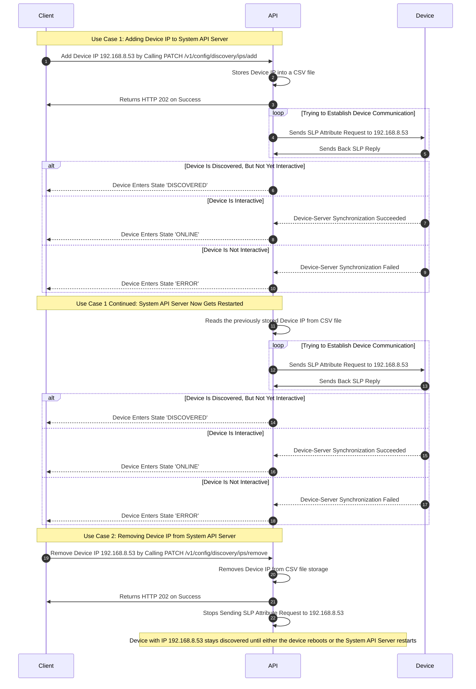

# Manual Device Discovery (By IP Address)

## Overview

System API Server supports two forms of networked device discovery:
- **Automatic discovery of devices on the same subnet as System API Server**, achieved through multicast messages.
- **Manual discovery of devices on different subnets from System API Server**, achieved through unicast Service Location Protocol messages.

Refer to [Unicast And Multicast Discovery Guide](https://www.geeksforgeeks.org/difference-between-unicast-broadcast-and-multicast-in-computer-network/) to learn more about the different means of communication over a TCP/IP network.

Networked device(s) can be manually discovered by System API Server if and only if:
- [x] The IP address(es) are added to the manual device discovery list (as explained in this guide).
- [x] A network route (or a series of routes) exist between the subnet System API Server is using to monitor and control Shure devices, and one or more subnets containing additional Shure devices. Refer to the [Establishing Routes Between Device Networks](?#establishing-routes-between-device-networks) section of this guide to learn more about creating static routes in your operating system if these are not already present on your router.

System API Server provides APIs which control this discovery procedure:

- Getting the list of device IP addresses
- Adding to the list of device IP addresses
- Replacing the list of device IP addresses
- Removing one or more IP address(es) from the list of device IP addresses
- Clearing the entire list of device IP addresses

## Prerequisites

### Establishing Routes Between Device Networks

In order for System API Server to discover devices which are outside of the subnet provided during installation to monitor and control Shure devices on, network traffic must be forwarded to and from any other subnets containing Shure devices by either your router(s), or your operating system(s). Below are some commonly used commands in frequently used operating systems to add and store persistent routes (which will persist across machine restarts) to the IP routing table.

<!--
type: tab
title: Windows
-->

**To find existing IP routes stored on Windows system, open CMD and run the following command.**

```text
route print
```

**To add a persistent route, run the following command.**

```text
route -p ADD destination_network MASK subnet_mask gateway_ip METRIC metric_cost IF interface_id
```

`-p` flag added to the command above makes the routes persistent across system reboots.

`interface_id` is simply a network interface identifier which can be fetched by calling `route print` command.

`metric_cost` is a cost value (typically positive integer) used by routers to determine the best path to a destination network, if multiple paths are possible. The lowest cost route is the one the router will select.

**To delete an existing route, run the following command.**

```text
route DELETE destination_network
```

Refer to the following external guide to learn more adding routes on Windows.

- [Adding Static TCP/IP Routes to the Windows Routing Table](https://www.howtogeek.com/howto/windows/adding-a-tcpip-route-to-the-windows-routing-table/)

<!--
type: tab
title: Red Hat / CentOS / Fedora
-->

**To find existing IP routes stored on Linux system, run the following command on the terminal.**

```text
ip route
```

**To add a persistent route, run the following command.**

```text
route -p add -net destination_network netmask subnet_mask -gateway gateway_ip metric metric_cost
```

`-p` flag added to the command above makes the routes persistent across system reboots.

`metric_cost` is a cost value (typically positive integer) used by routers to determine the best path to a destination network, if multiple paths are possible. The lowest cost route is the one the router will select.

**To delete an existing route, run the following command.**

```text
route del -net destination_network
```

Refer to the following external guides to learn more about adding routes on these distros.

- [Configuring Temporary Static Routes](https://access.redhat.com/documentation/en-us/red_hat_enterprise_linux/7/html/networking_guide/sec-configuring_static_routes_with_ip_commands)
- [Configuring Persistent Static Routes](https://access.redhat.com/documentation/en-us/red_hat_enterprise_linux/7/html/networking_guide/sec-configuring_static_routes_in_ifcfg_files#bh-Static_Routes_Using_the_IP_Command_Arguments_Format)

<!--
type: tab
title: Debian / Ubuntu
-->

**To find existing IP routes stored on Ubuntu system, open CMD and run the following command.**

```text
route
```

**To add a persistent route, run the following command.**

```text
up route add -net destination_network netmask subnet_mask network_interface_name
```

`up` flag added to the command above makes the routes persistent across system reboots.

`interface_interface_name` is simply a network interface identifier which can be fetched by calling `route` command.

**To delete an existing route, run the following command.**

```text
route del -net destination_network
```

Refer to the following external guide to learn more adding routes on these distros.

- [Setting up Routing Tables](https://ubuntu.com/core/docs/networkmanager/routing-tables)

<!-- type: tab-end -->

## Supported Operations

### Get List of Device IPs

To see the IP addresses System API Server will use to try to find additional devices, call [`GET /v1/config/discovery/ips`](https://shure.stoplight.io/docs/shure-system-api-specification/95108a7c3bc1c-get-ip-addresses-of-devices-to-manually-discover) API.

<!--
type: tab
title: Request
-->

```json http
{
  "method": "GET",
  "baseUrl": "https://127.0.0.1:10000",
  "url": "/api/v1/config/discovery/ips",
  "headers": {
    "x-api-key": "",
    "Content-Type": "application/json"
  }
}
```

<!--
type: tab
title: Response
-->

```json
{
  "ips": [
    "192.168.180.123","192.168.180.121"
  ]
}
```

<!-- type: tab-end -->

### Add List of Device IPs

To add to the list of IP addresses System API Server will use to try to find additional devices, call [`PATCH /v1/config/discovery/ips/add`](https://shure.stoplight.io/docs/shure-system-api-specification/249e20723c902-add-ip-addresses-of-devices-to-manually-discover) API.

<!-- theme: success -->

> #### Stored Device IPs Persists Across System Reboots
>
> All the added list of device IPs are stored in a CSV file located in the directory specified by `Application.DataFolderPath` value in `appsettings/appsettings.json5` file.

<!-- theme: info -->

> #### Discovery of Devices Added By IP for Manual Unicast Discovery
>
> Once the list of device IP addresses has been updated, System API Server will return a success from [`PATCH /v1/config/discovery/ips/add`](https://shure.stoplight.io/docs/shure-system-api-specification/249e20723c902-add-ip-addresses-of-devices-to-manually-discover). The device discovery will happen asynchronously discovered after asynchronously the API call completes, and if the device(s) are reachable at the IP addresses provided, then the provide device(s) will transition through the device discovery states as explained in the [Device Discovery Lifecycle Guide](../docs/Device-Discovery-Lifecycle.md).

<!--
type: tab
title: Request
-->

```json http
{
  "method": "PATCH",
  "baseUrl": "https://127.0.0.1:10000",
  "url": "/api/v1/config/discovery/ips/add",
  "headers": {
    "x-api-key": "",
    "Content-Type": "application/json"
  },
  "body":{
    "ips":[
"192.168.1.12","192.168.1.125"
    ]
  }
}
```

<!--
type: tab
title: Response
-->

```text
   Empty 202 response
```

<!-- type: tab-end -->

### Replace List of Device IPs

To replace the current list of IP addresses of devices to manually discover with a newly provided list, call [`PUT /v1/config/discovery/ips`](https://shure.stoplight.io/docs/shure-system-api-specification/2dc8eb283399e-update-ip-addresses-of-devices-to-manually-discover).

<!--
type: tab
title: Request
-->

```json http
{
  "method": "PUT",
  "baseUrl": "https://127.0.0.1:10000",
  "url": "/api/v1/config/discovery/ips",
  "headers": {
    "x-api-key": "",
    "Content-Type": "application/json"
  },
  "body":{
    "ips":[
"192.168.1.12","192.168.1.125"
    ]
  }
}
```

<!--
type: tab
title: Response
-->

```text
   Empty 202 response
```

<!-- type: tab-end -->

### Remove List of Device IPs

To remove a specified list of IP addresses of devices from being manually discovered through unicast discovery, call
[`PATCH /v1/config/discovery/ips/remove`](https://shure.stoplight.io/docs/shure-system-api-specification/973ddffea098a-remove-ip-addresses-of-devices-to-manually-discover) API.

<!-- theme: warning -->
> #### Removing Already Discovered Devices
>
> Once a list of device IPs are removed from being discovered using this API, devices which were already discovered by the API will remain discovered until and unless either the device gets rebooted or the System API Server restarts.

<!--
type: tab
title: Request
-->

```json http
{
  "method": "PATCH",
  "baseUrl": "https://127.0.0.1:10000",
  "url": "/api/v1/config/discovery/ips/remove",
  "headers": {
    "x-api-key": "",
    "Content-Type": "application/json"
  },
  "body":{
    "ips":[
"192.168.1.12"
    ]
  }
}
```

<!--
type: tab
title: Response
-->

```text
   HTTP 202 Accepted
```

<!-- type: tab-end -->

### Clear List of Device IPs

To clear the entire list of IP addresses of devices from being manually discovered through unicast discovery, call
[`DELETE /v1/config/discovery/ips`](https://shure.stoplight.io/docs/shure-system-api-specification/485ee63d2223f-clear-ip-addresses-of-devices-to-manually-discover) API.

<!-- theme: warning -->
> #### Removing Already Discovered Devices
>
> Once a list of device IPs are cleared from being discovered using this API, devices which were already discovered by the API will remain discovered until and unless either the device gets rebooted or the System API Server restarts.

<!--
type: tab
title: Request
-->

```json http
{
  "method": "DELETE",
  "baseUrl": "https://127.0.0.1:10000",
  "url": "/api/v1/config/discovery/ips",
  "headers": {
    "x-api-key": "",
    "Content-Type": "application/json"
  }
}
```

<!--
type: tab
title: Response
-->

```text
   HTTP 202 Accepted
```

<!-- type: tab-end -->

## API Workflow With Example

The sequence diagram below illustrates how these APIs can be used meaningfully to attempt discovery on a single device in a client application:

1. Device IP gets added by calling `PATCH /v1/config/discovery/ips/add`
2. System API Server then gets restarted, and re-discovers the device from step 1 at the IP address provided in step 1.
3. The manually discovered device IP then gets removed by calling `PATCH /v1/config/discovery/ips/remove`.


