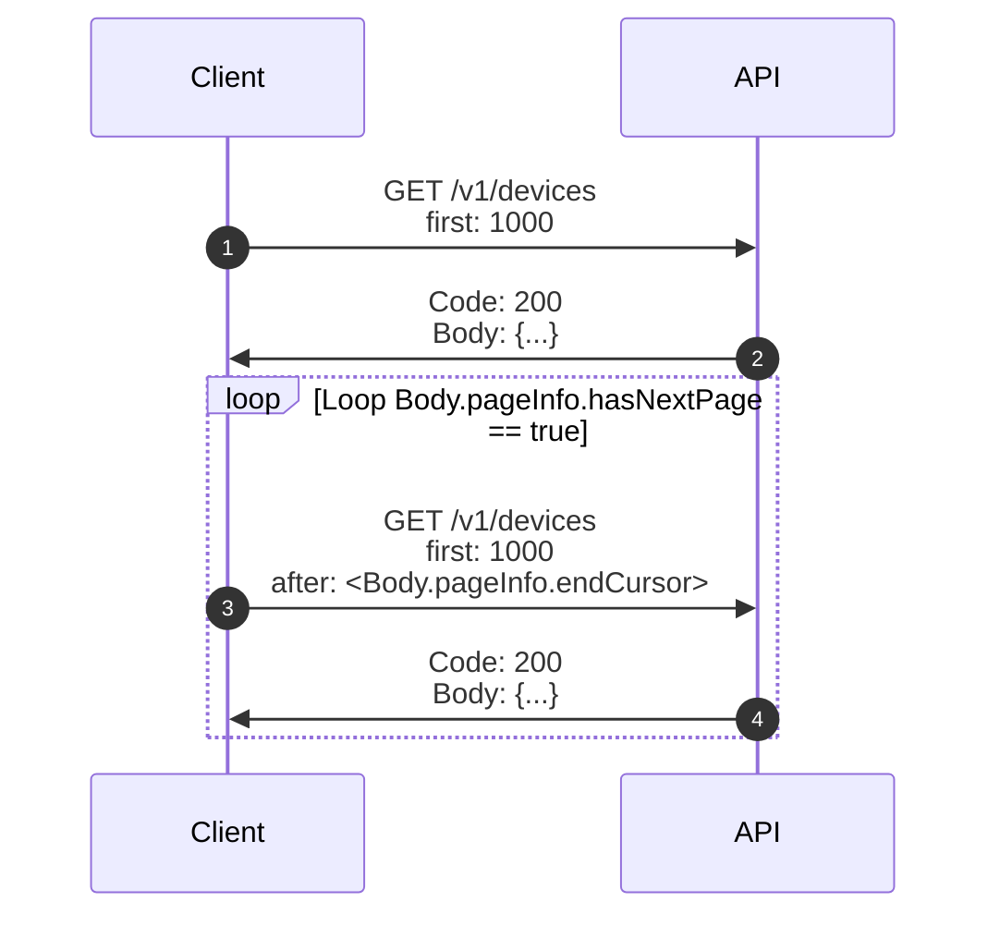
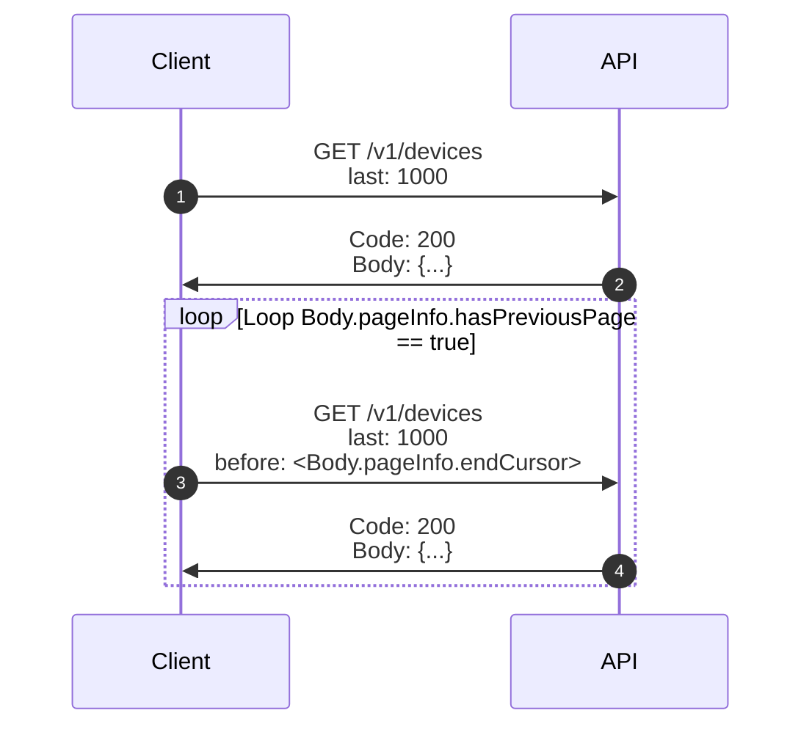

# Response Pagination
## Overview
The "Get All Devices" operation (`GET /v1/devices`) returns a maximum of 1,000 discovered devices in a single request. If more than 1,000 devices are discovered by the API, clients must send successive requests to obtain all devices.

This guide establishes how to leverage the paging parameters in order to
- retrieve all device information in large scale deployments
- navigate a reduced result set, if desired

## Examples
### Forward Page Order



1. Send the first `GET` request to the `/v1/devices` API endpoint with the `first` query parameter set to `1000`

    ```
    GET /api/v1/devices?first=1000 HTTP/1.1
    Host: {host}:{port}
    Content-Type: application/json
    ```

1. The server will process this request and send back a successful response containing a JSON body. The body will contain information about this "page" of results on the `pageInfo` property, as well as the device results themselves inside of the `edges` property. In the following example, the `pageInfo.hasNextPage` property indicates that there are additional results which were omitted from this page. 

    ```json
    {
      "pageInfo": {
        "hasNextPage": true,
        "hasPreviousPage": false,
        "startCursor": "eyJmIjoiRCIsImEiOiJhNDk3YjFkYi0xYmY3LTExZTktYTAwMC0wMDBlZGRhYWFhYWEifQ==",
        "endCursor": "eyJmIjoiRCIsImEiOiJkZDYwZDA2YS0wMDAwLTExZGQtYTAwMC0wMDBlZGRjY2NjY2MifQ=="
      },
      "edges": [
        ...(999 other records),
        {
          "cursor": "string",
          "node": {
            "compatibility": "COMPATIBLE_LATEST",
            "deviceState": "ONLINE",
            "hardwareIdentity": {
              "deviceId": "DD123456-0000-11DD-A000-000EDDCCCCCC",
              "serialNumber": "2AA2123456"
            },
            "softwareIdentity": {
              "firmwareVersion": "6.0.38",
              "firmwareValid": true,
              "model": "P300"
            },
            "communicationProtocol": {
              "name": "ESTA.DMP",
              "address": "192.168.1.100"
            },
            "capabilities": [
              ...
            ]
          }
        }
      ]
    }
    ```

1. Additional `GET` requests must be sent to the `/v1/devices` endpoint to retrieve all devices. Each subsequent request must extract the value of `pageInfo.startCursor` from the preceding response body and provide it (url-encoded) as the value of the `before` query parameter. 

    ```
    GET /api/v1/devices?first=1000&after=eyJmIjoiRCIsImEiOiJkZDYwZDA2YS0wMDAwLTExZGQtYTAwMC0wMDBlZGRjY2NjY2MifQ%3D%3D HTTP/1.1
    Host: {host}:{port}
    Content-Type: application/json
    ```

1. Repeat the previous step until results have been exhausted (`pageInfo.hasNextPage == false`)


### Reverse Page Order



1. Send the first `GET` request to the `/v1/devices` API endpoint with the `last` query parameter set to `1000`

    ```http
    GET /api/v1/devices?last=1000 HTTP/1.1
    Host: {host}:{port}
    Content-Type: application/json
    ```

1. The server will process this request and send back a successful response containing a JSON body. The body will contain information about this "page" of results on the `pageInfo` property, as well as the device results themselves inside of the `edges` property. In the following example, the `pageInfo.hasPreviousPage` property indicates that there are additional results which were omitted from this page, and that a client can continue traversing through pages - in reverse order.

    ```json
    {
      "pageInfo": {
        "hasNextPage": true,
        "hasPreviousPage": false,
        "startCursor": "eyJmIjoiRCIsImEiOiJhNDk3YjFkYi0xYmY3LTExZTktYTAwMC0wMDBlZGRhYWFhYWEifQ==",
        "endCursor": "eyJmIjoiRCIsImEiOiJkZDYwZDA2YS0wMDAwLTExZGQtYTAwMC0wMDBlZGRjY2NjY2MifQ=="
      },
      "edges": [
        ...(999 other records),
        {
          "cursor": "string",
          "node": {
            "deviceState": "Available",
            "hardwareIdentity": {
              "deviceId": "DD123456-0000-11DD-A000-000EDDCCCCCC",
              "serialNumber": "2AA2123456"
            },
            "softwareIdentity": {
              "firmwareVersion": "4.5.0",
              "firmwareValid": true,
              "model": "P300"
            },
            "communicationProtocol": {
              "name": "ESTA.DMP",
              "address": "192.168.1.100"
            },
            "capabilities": [
              "firmware-version"
            ]
          }
        }
      ]
    }
    ```

1. Additional `GET` requests must be sent to the be sent to the `/v1/devices` endpoint. Each subsequent request must extract the value of `pageInfo.startCursor` from the preceding response body and provide it (url-encoded) as the value of the `before` query parameter. 

    ```
    GET /api/v1/devices?last=1000&after=eyJmIjoiRCIsImEiOiJkZDYwZDA2YS0wMDAwLTExZGQtYTAwMC0wMDBlZGRjY2NjY2MifQ%3D%3D HTTP/1.1
    Host: {host}:{port}
    Content-Type: application/json
    ```

1. Repeat the previous step until results have been exhausted (`pageInfo.hasPreviousPage == false`)
