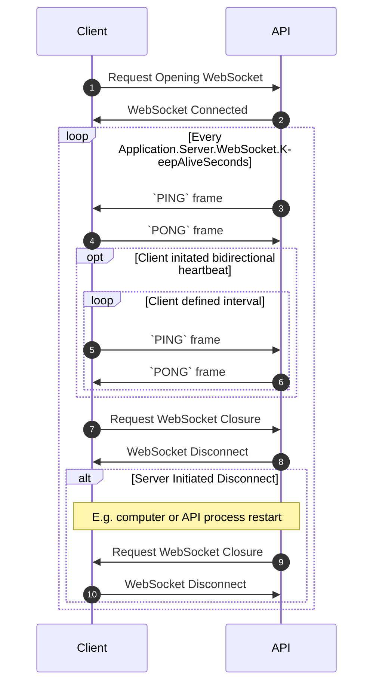

# WebSocket FAQs
Read the frequently asked questions about using WebSockets with this API.

## How can I keep my WebSocket from prematurely closing?
This API supports a "keepalive" mechanism for ensuring that subscriptions which do not update frequently remain active regardless of any intermediate network infrastructure which may terminate seemingly unused connections. This problem often surfaces on enterprise networks that are optimizing to reduce needless network utilization. 

The keepalive mechanism is described in detail in [RFC 6455, sections 5.5.2-5.5.3](https://www.rfc-editor.org/rfc/rfc6455#section-5.5.2), using `PING` and `PONG` frames which are interpreted and understood by popular WebSocket libraries. The sequence diagram below describes the overarching messaging constructs that are happening over the WebSocket to do this. The takeaways try to summarize what you need to know about what is happening.

**Takeaways**
1) The sending of `PING` and `PONG` frames is likely handled by your WebSocket library in a way completely transparent to your application code. To see this network traffic, use network analyzers such as [Wireshark](https://www.wireshark.org/).

2) In most scenarios, the timeout in this API's configuration will be sufficient for keeping your WebSocket connection up and running without any changes in your code. In the event your environment has more aggressive WebSocket termination code, this API's interval can be configured lower to avoid premature termination.

3) No matter whether your code sends `PING` or `PONG` frames, this API continuously sends its own `PING` frames to ensure your RFC-compliant WebSocket library issues them in return. This ensures reliable data transport. 

**Keepalive Sequence**

