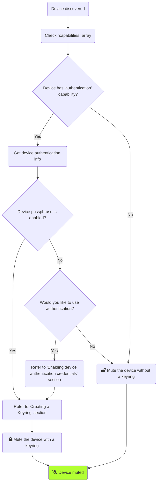
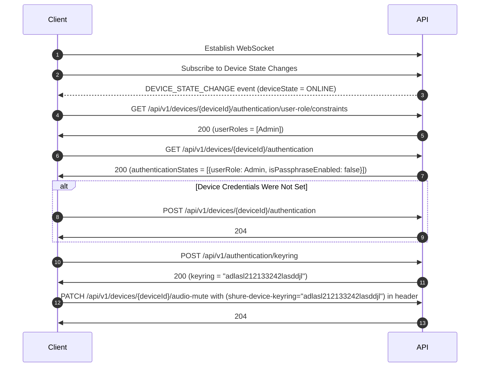

# Device Authentication Guide

## Overview
Many Shure devices have the ability to secure their communication with controlling applications using a passphrase-based authentication flow. This can be used to prevent unauthorized changes to the devices. In order to authenticate your device-related operations, System API expects a keyring to be created, which encrypts your passphrases. One or more keyrings will be used across subsequent API requests instead of device passphrases. Keyrings can protect your passphrases as long as they remain securely stored. 



This guide will go into more detail about the following topics:
- Overview - How to mute or unmute an authenticated device?
- Enabling and disabling device authentication
- Creating and updating keyrings

## Userflow to mute/unmute a device with a keyring

Perform the following steps to mute/unmute a device:

- Please refer the [Getting Started Guide](../../docs/Getting-Started.md#your-first-api-subscription) on how to open websocket.
- Establish a subscription for device state changes using the API:<br>`POST /api/v1/devices/subscription/{transportId}`
- On device discovery event, get the user role constraints for the device using the API:<br>`GET /api/v1/devices/{deviceId}/authentication/user-role/constraints`
- Check if the credentials for the user role are set or not using the API:<br> `GET /api/v1/devices/{deviceId}/authentication`
- If the credentials are not enabled, set device authentication credentials using the API:<br>`POST /api/v1/devices/{deviceId}/authentication`
- Generate keyring for the device using the API:<br>`POST /api/v1/authentication/keyring`
- Mute/Unmute the device using the API:<br>`PATCH /api/v1/devices/{deviceId}/audio-mute`




## Device Authentication
Device Authentication prevents control of devices from unauthorized users through the API.

Following operations are the API contracts which assist device authentication feature:

#### Get User Role Constraints for a device

To get the supported user roles for a device, call [`GET /api/v1/devices/{deviceId}/authentication/user-role/constraints`](https://shure.stoplight.io/docs/shure-system-api-specification/9cb529d54f751-get-device-authentication-user-role-constraints) API.

Below is an example request and response.

<!-- 
type: tab
title: Request
-->
```json http
{
  "method": "GET",
  "baseUrl": "https://127.0.0.1:10000",
  "url": "/api/v1/devices/{deviceId}/authentication/user-role/constraints",
  "headers": {
    "x-api-key": "",
    "Content-Type": "application/json"
  }
}
```

<!-- 
type: tab
title: Response
-->
On success, a 200 response is received and the list of supported user roles is returned in the JSON body.
```json
{
  "userRoles": [
    "Admin"
  ]
}
```
<!-- type: tab-end -->

#### Get Device Authentication Information

To determine whether or not an authorization challenge must be passed to interact with a device, call [`GET /api/v1/devices/{deviceId}/authentication`](https://shure.stoplight.io/docs/shure-system-api-specification/56c0328b1abc4-get-device-authentication-information) API.

Below is an example request and response.

<!-- 
type: tab
title: Request
-->
```json http
{
  "method": "GET",
  "baseUrl": "https://127.0.0.1:10000",
  "url": "/api/v1/devices/{deviceId}/authentication",
  "headers": {
    "x-api-key": "",
    "Content-Type": "application/json"
  }
}
```

<!-- 
type: tab
title: Response
-->
On success, a 200 response is received and the authentication states specified for each supported user role is returned in the JSON body.
```json
{
   "authenticationStates": [
    {
      "userRole": "Admin",
      "passphraseEnabled": true
    }
  ]
}
```
<!-- type: tab-end -->

#### Enabling device authentication credentials

To enable device authentication, call [`POST /api/v1/devices/{deviceId}/authentication`](https://shure.stoplight.io/docs/shure-system-api-specification/e0de3ea5844d7-enable-device-authentication) API and provide the user role for which authentication should be set for, and the passphrase you want to set. Additionally, if enabling authentication on a user role other than the `Admin` role, the current admin passphrase must be provided in the keyring.

Below is an example request and response.

<!-- 
type: tab
title: Request
-->
```json http
{
  "method": "POST",
  "baseUrl": "https://127.0.0.1:10000",
  "url": "/api/v1/devices/{deviceId}/authentication",
  "headers": {
    "x-api-key": "",
    "Content-Type": "application/json"
  },
  "body": {
    "userRole": "Admin",
    "passphrase": "<insertyourpassphrasehere>",
  }
}
```

<!-- 
type: tab
title: Response
-->
On success, a 204 response is received.
<!-- type: tab-end -->

#### Disabling device authentication credentials

To disable device authentication, call [`DELETE /api/v1/devices/{deviceId}/authentication`](https://shure.stoplight.io/docs/shure-system-api-specification/b700efa521c32-disable-device-authentication) API and provide the user role to disable authorization challenges on, and the current admin passphrase must be provided in the keyring.

Below is an example request and response.

<!-- 
type: tab
title: Request
-->
```json http
{
  "method": "DELETE",
  "baseUrl": "https://127.0.0.1:10000",
  "url": "/api/v1/devices/{deviceId}/authentication",
  "headers": {
    "x-api-key": "",
    "Content-Type": "application/json"
  },
  "body": {
    "userRole": "Admin"
  }
}
```

<!-- 
type: tab
title: Response
-->
On success, a 204 response is received.
<!-- type: tab-end -->

#### Updating device authentication credentials

To change a passphrase once authentication is enabled, call [`PATCH /api/v1/devices/{deviceId}/authentication`](https://shure.stoplight.io/docs/shure-system-api-specification/f89e07cbc31a9-update-device-authentication) API and provide the user role which requires an updated passphrase, the updated passphrase, and the current admin passphrase must be provided in the keyring.

Below is an example request and response.

<!-- 
type: tab
title: Request
-->
```json http
{
  "method": "PATCH",
  "baseUrl": "https://127.0.0.1:10000",
  "url": "/api/v1/devices/{deviceId}/authentication",
  "headers": {
    "x-api-key": "",
    "Content-Type": "application/json"
  },
  "body": {
    "userRole": "Admin",
    "newPassphrase": "<insertyournewpassphrasehere>"
  }
}
```

<!-- 
type: tab
title: Response
-->
On success, a 204 response is received.
<!-- type: tab-end -->

## Keyring
A *keyring* is an encrypted string containing authentication credentials for one or more device(s) and needs to be provided using the `shure-device-keyring` HTTP request header  for operations which might affect the device state and behavior. The documentation for each endpoint specifies whether or not the keyring must be provided in the HTTP request headers.

<!-- theme: info -->
> #### Allowed Operations without Authentication
>
> Device authentication governs the majority of state and behavior changes possible on Shure devices implementing this feature. However, there are noteworthy exceptions to be aware of which do not require a keyring:
> - Device Identify
> - Firmware Update

<!-- theme: danger -->
> #### Protecting Keyring and Keyring Secret 
>
> Keyring and Keyring Secret shall be protected and made sure they don't fall into unauthorized hands as anyone who has the Keyring and Keyring Secret can access your device and control it without any restriction!

### Keyring Management
For each device with the authentication feature enabled, it's passphrase must be included in some keyring (whether a new keyring is created or an existing keyring is updated) in order to perform state and behavior changes on it.

Following operations are the API contracts which manage keyrings:

#### Creating a Keyring

To create a keyring for a list of devices, call [`POST /api/v1/authentication/keyring`](https://shure.stoplight.io/docs/shure-system-api-specification/5e537508beafe-create-keyring) API and provide the device IDs and passphrases which should be included in the keyring.

Below is an example request and response.

<!-- 
type: tab
title: Request
-->
```json http
{
  "method": "POST",
  "baseUrl": "https://127.0.0.1:10000",
  "url": "/api/v1/authentication/keyring",
  "headers": {
    "x-api-key": "",
    "Content-Type": "application/json"
  },
  "body": [
    {
      "deviceId": "DD123456-0000-11DD-A000-000EDDCCCCCC",
      "passphrase": "<insertyourpassphrasehere>",
    }
  ]
}
```

<!-- 
type: tab
title: Response
-->
On success, a 200 response is received and the created keyring string is returned in the JSON body.
```json
{
  "keyring": ""
}
```
<!-- type: tab-end -->

#### Updating a Keyring

To update an existing keyring, call [`PATCH /api/v1/authentication/keyring`](https://shure.stoplight.io/docs/shure-system-api-specification/803d6c392bbe4-update-keyring) API and provide the existing keyring and the updates for device IDs and passphrases which should be included/removed/updated in the keyring.

<!-- theme: info -->
> Updating a keyring supports any of the following operations:
> - Adding a device to the keyring 
> - Removing a device from the keyring
> - Updating the authentication credentials for a device in the keyring
> See [Update Keyring endpoint description](https://shure.stoplight.io/docs/shure-system-api-specification/803d6c392bbe4-update-keyring) for more details on how to perform the above operations.

Below is an example request and response.

<!-- 
type: tab
title: Request
-->
```json http
{
  "method": "PATCH",
  "baseUrl": "https://127.0.0.1:10000",
  "url": "/api/v1/authentication/keyring",
  "headers": {
    "x-api-key": "",
    "Content-Type": "application/json"
  },
  "body": {
    "keyring": "<insertyourkeyringhere>",
    "info": [
      {
        "deviceId": "DD123456-0000-11DD-A000-000EDDCCCCCC",
        "passphrase": "<insertyourpassphrasehere>"
      }
    ]
  }
}
```

<!-- 
type: tab
title: Response
-->
On success, a 200 response is received and the updated keyring string is returned in the JSON body.
```json
{
  "keyring": ""
}
```
<!-- type: tab-end -->

<!-- theme: warning -->
> #### Discard existing keyring after update 
>
> On calling the update keyring API contract, a new keyring is generated and returned. For any requests on the device, the new keyring which has that particular device authentication credentials shall be provided.

#### Inspecting a Keyring

To inspect a keyring to get the list of devices which were added in the keyring, call [`POST /api/v1/authentication/keyring/inspect`](https://shure.stoplight.io/docs/shure-system-api-specification/6154af0677010-inspect-keyring) API and provide the keyring string.

Below is an example request and response.

<!-- 
type: tab
title: Request
-->
```json http
{
  "method": "POST",
  "baseUrl": "https://127.0.0.1:10000",
  "url": "/api/v1/authentication/keyring/inspect",
  "headers": {
    "x-api-key": "",
    "Content-Type": "application/json"
  },
  "body": {
    "keyring": ""
  }
}
```

<!-- 
type: tab
title: Response
-->
On success, a 200 response is received and the list of device IDs is returned in the JSON body.
```json
{
  "deviceIds": [
    "DD123456-0000-11DD-A000-000EDDCCCCCC"
  ]
}
```
<!-- type: tab-end -->
