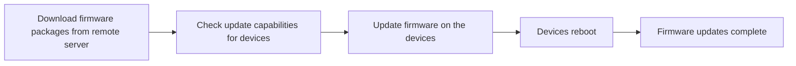
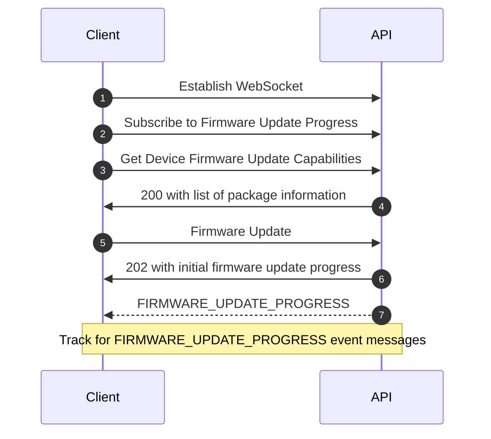

# Firmware Update Guide

## Introduction
System API Server supports firmware updating Shure's networked devices. This guide will describe the firmware update process in detail. Each operation, and its associated steps, are expanded upon in the following sections.

The guide will conclude with examples of how to **schedule firmware updates**. 

## The Flow

The firmware update procedure as described in the flowchart is sequential and serial. 
*Failing to satisfy each step's preconditions before proceeding to attempt the next step may lead to unexpected results!*  

For example, when determining if a device is capable of receiving a firmware update, one must first download firmware packages from the remote server. 
Failing to do so would result in seeing an empty array of firmware packages a device is capable of updating to, as the necessary firmware packages are not cached on the server.

## Glossary

Keyword | Definition
---------|----------
 Device Firmware Update Capability | The firmware package a device can be updated to based on the firmware packages which have been downloaded. 
 Device Progress Percentage | The overall progress percentage of a firmware update on a device. 
 Hosted Package | A firmware package which is uploaded to a device that will *host* the firmware package for a *different* device which System API Server cannot directly communicate with. E.g. A ULXD4 Networked Receiver hosts packages for ULXD1 and ULXD2 Transmitters.
 Key or Firmware Package Key | The name of the firmware package. EG: For the package file "MXA910.3.0.24.pack", the package key would be "MXA910". 
 Primary Package| Primary packages are ones that can be applied directly to the device at the time of the update request. 
 Progress Percentage | The overall progress percentage of all device firmware updates in a given firmware update request.
 Release Date | The release date of a given package which is on the remote package server. 
 Release Notes Url | A URL to the release notes for the specified package.
 Request State | The state of the update request.
 Stage Progress Percentage | The completion progress percentage of the specified stage of firmware update on a device.
 Update Stage | The current stage (or phase) of firmware update on a device. A firmware update for a device goes through multiple stages.
 Update Status | The current status for a stage of firmware update on a device. 
 Version or Firmware Package Version | The version of the specified firmware package. E.g: For the package file "MXA910.3.0.24.pack", the firmware package version would be "3.0.24.0".

## System level operations

System level operations are the API contracts which assist with firmware update operations and aren't specific to a device. The following operations are used to ensure pre-conditions are met before we can begin to firmware update devices:

### Check the reachability of the firmware package server
The firmware package server is a remote server maintained by Shure (Internet accessible) where the latest firmware packages for Shure devices are made available.

<!-- theme: warning -->
> #### What if the server isn't available?
> If the server isn't available, you cannot download packages from the remote server and will have to use the firmware packages which were downloaded previously. **On a fresh installation, there won't be any firmware packages and you must download from the server to use the feature.**

To check the if the server is available or not, call `GET /api/v1/firmware/server-status` API

Below is an example request and response.

<!-- 
type: tab
title: Request
-->
```json http
{
  "method": "GET",
  "baseUrl": "https://127.0.0.1:10000",
  "url": "/api/v1/firmware/server-status",
  "headers": {
    "x-api-key": "",
    "Content-Type": "application/json"
  }
}
```

<!-- 
type: tab
title: Response
-->
On success, a 200 response is received and the current server status is in the JSON body.
```json
{
  "available": true
}
```
<!-- type: tab-end -->

### Subscribe for the reachability status of the firmware package server

The System API supports subscribing to the changes to the status of the firmware package server. To use this API, you must first set up a [WebSocket](https://wikipedia.org/wiki/WebSocket) connection in your application to acquire a `transportId`.  Once you have the WebSocket transportId you can use the `POST /api/v1/firmware/server-status/subscription/{transportId}` API to trigger firmware package server status change messages to be delivered over the WebSocket.

<!-- theme: info -->
> The `envelope.eventName` field in the message can be used to distinguish firmware package server status events from other subscription events. See the example below for details.

<!-- 
type: tab
title: Request
-->

```json http
{
  "method": "POST",
  "baseUrl": "https://127.0.0.1:10000",
  "url": "/api/v1/firmware/server-status/subscription/{transportId}",
  "headers": {
    "x-api-key": "",
    "Content-Type": "application/json"
  }
}
```

<!-- 
type: tab
title: Response
-->
```text
   Empty 201 response
```

<!-- 
type: tab
title: Subscription Event
-->
Example event when the firmware package server state change.

```json
{
  "envelope": {
    "eventName": "FIRMWARE_PACKAGE_SERVER_STATUS"
  },
  "body": {
    "available": true
  }
}
```
<!-- type: tab-end -->


### Unsubscribe: Firmware Package Server State

To unsubscribe from firmware package server state changes use the `DELETE /api/v1/firmware/server-status/subscription/{transportId}` API. This API will prevent future package server state change messages from being received over the WebSocket. This API will not affect the WebSocket or other subscriptions.

<!-- 
type: tab
title: Request
-->
```json http
{
  "method": "DELETE",
  "baseUrl": "https://127.0.0.1:10000",
  "url": "/api/v1/firmware/server-status/subscription/{transportId}",
  "headers": {
    "x-api-key": "",
    "Content-Type": "application/json"
  }
}
```

<!-- 
type: tab
title: Response
-->
```text
   Empty 204 response
```
<!-- type: tab-end -->

### Retrieve the list of firmware packages available for download

This API contract provides a list of all firmware packages which are available on the remote server and can be downloaded.

<!-- theme: info -->
> #### Why do I need this list of firmware packages?
> This list of firmware packages which are available for download is required as you need to specify which package key and version you would like to download.

Retrieve the list of firmware packages available for download, call `GET /api/v1/firmware/download/available` API

Below is an example request and response.

<!-- 
type: tab
title: Request
-->
```json http
{
  "method": "GET",
  "baseUrl": "https://127.0.0.1:10000",
  "url": "/api/v1/firmware/download/available",
  "headers": {
    "x-api-key": "",
    "Content-Type": "application/json"
  }
}
```

<!-- 
type: tab
title: Response
-->
On success, a 200 response is received and the current server status is in the JSON body.
```json
[
  {
    "key": "MXA910",
    "version": "2.0.16.0",
    "description": "MXA910 Ceiling Array Microphone",
    "releaseNotesUrl": "http://www.shure.com/en-US/support/downloads/software-firmware-archive/mxa910-microflex-advance-ceiling-array-microphone",
    "releaseDate": "2020-11-23"
  }
]
```
<!-- type: tab-end -->

### Subscribe to changes in firmware packages available for download

The System API supports subscribing to the changes in the availability of the firmware packages on the server. To use this API, you must first set up a [WebSocket](https://wikipedia.org/wiki/WebSocket) connection in your application to acquire a `transportId`.  Once you have the WebSocket transportId you can use the `POST /api/v1/firmware/download/available/subscription/{transportId}` API to trigger firmware package download available messages to be delivered over the WebSocket.

<!-- theme: info -->
> The `envelope.eventName` field in the message can be used to distinguish firmware package server status events from other subscription events. See the example below for details.

<!-- 
type: tab
title: Request
-->

```json http
{
  "method": "POST",
  "baseUrl": "https://127.0.0.1:10000",
  "url": "/api/v1/firmware/download/available/subscription/{transportId}",
  "headers": {
    "x-api-key": "",
    "Content-Type": "application/json"
  }
}
```

<!-- 
type: tab
title: Response
-->
```text
   Empty 201 response
```

<!-- 
type: tab
title: Subscription Event
-->
Example event when the firmware package download availability state change.

```json
{
  "envelope": {
    "eventName": "FIRMWARE_PACKAGE_AVAILABLE"
  },
  "body":  [
    {
      "key": "MXA910",
      "version": "2.0.16.0",
      "description": "MXA910 Ceiling Array Microphone",
      "releaseNotesUrl": "http://www.shure.com/en-US/support/downloads/software-firmware-archive/mxa910-microflex-advance-ceiling-array-microphone",
      "releaseDate": "2020-11-23"
    }
  ]
}
```
<!-- type: tab-end -->

### Unsubscribe: Firmware Packages Available For Download

To unsubscribe from firmware package download availability changes use the `DELETE /api/v1/firmware/download/available/subscription/{transportId}` API. This API will prevent future firmware package download availability change messages from being received over the WebSocket. This API will not affect the WebSocket or other subscriptions.

<!-- 
type: tab
title: Request
-->
```json http
{
  "method": "DELETE",
  "baseUrl": "https://127.0.0.1:10000",
  "url": "/api/v1/firmware/download/available/subscription/{transportId}",
  "headers": {
    "x-api-key": "",
    "Content-Type": "application/json"
  }
}
```

<!-- 
type: tab
title: Response
-->
```text
   Empty 204 response
```
<!-- type: tab-end -->

### Download Device Firmware Packages

This API contract downloads the requested firmware packages from the remote server. Packages which were previously downloaded will be re-downloaded.

<!-- theme: info -->
> #### Why do I need to download the firmware packages?
> Downloading the firmware packages locally prior to a firmware update ensures a reliable file transfer occurs for the firmware update onto your Shure devices.
> Only firmware packages which are downloaded locally can be specified.

To download firmware packages to the System API server in order to firmware update devices, call the `POST /api/v1/firmware/download` API.

Below is an example request and response.

<!-- 
type: tab
title: Request
-->
```json http
{
  "method": "POST",
  "baseUrl": "https://127.0.0.1:10000",
  "url": "/api/v1/firmware/download",
  "headers": {
    "x-api-key": "",
    "Content-Type": "application/json"
  },
  "body": [
    {
      "firmwarePackageKey": "MXA910",
      "firmwarePackageVersion": "4.4.11.0"
    }
  ]
}
```

<!-- 
type: tab
title: Response
-->
On success, a 202 response is received and the initial download progress status is in the JSON body.
```json
[
  {
    "requestId": "d385ab22-0f51-4b97-9ecd-b8ff3fd4fcb6",
    "progressPercentage": 0,
    "requestState": "PENDING",
    "firmwarePackageDownloadProgress": [
      {
        "key": "MXA910",
        "version": "4.4.11.0",
        "progressPercentage": 0,
        "downloadStage": "PENDING"
      }
    ]
  }
]
```
<!-- type: tab-end -->

### Retrieve the firmware package download statuses for the request specified by downloadRequestId

To retrieve the firmware package download statuses, call the `GET /api/v1/firmware/download/progress/{downloadRequestId}` API

<!-- theme: warning -->
> Shure strongly encourages subscribing to events instead of polling for optimal performance of your applications and of your System API Server instance.
> Consider the corresponding subscription API if it is more suitable for your usage and application requirements.

Below is an example request and response.

<!-- 
type: tab
title: Request
-->
```json http
{
  "method": "GET",
  "baseUrl": "https://127.0.0.1:10000",
  "url": "/api/v1/firmware/download/progress/{downloadRequestId}",
  "headers": {
    "x-api-key": "",
    "Content-Type": "application/json"
  }
}
```

<!-- 
type: tab
title: Response
-->
On success, a 200 response is received and the current progress status is in the JSON body.
```json
[
  "requestId": "d385ab22-0f51-4b97-9ecd-b8ff3fd4fcb6",
  "progressPercentage": 0,
  "requestState": "PENDING",
  "firmwarePackageDownloadProgress": [
    {
      "key": "MXA910",
      "version": "4.4.11.0",
      "progressPercentage": 0,
      "downloadStage": "PENDING"
    }
  ]
]
```
<!-- type: tab-end -->

### Subscribe to changes in firmware packages download progress

The System API supports subscribing to the changes in the progress of firmware packages download on the server. To use this API, you must first set up a [WebSocket](https://wikipedia.org/wiki/WebSocket) connection in your application to acquire a `transportId`.  Once you have the WebSocket transportId you can use the `POST /api/v1/firmware/download/progress/subscription/{transportId}` API to trigger firmware package download progress messages to be delivered over the WebSocket.

<!-- theme: info -->
> The `envelope.eventName` field in the message can be used to distinguish firmware package server status events from other subscription events. See the example below for details.

<!-- 
type: tab
title: Request
-->

```json http
{
  "method": "POST",
  "baseUrl": "https://127.0.0.1:10000",
  "url": "/api/v1/firmware/download/progress/subscription/{transportId}",
  "headers": {
    "x-api-key": "",
    "Content-Type": "application/json"
  }
}
```

<!-- 
type: tab
title: Response
-->
```text
   Empty 201 response
```

<!-- 
type: tab
title: Subscription Event
-->
Example event when the firmware package download progress change.

```json
{
  "envelope": {
    "eventName": "FIRMWARE_PACKAGE_DOWNLOAD_PROGRESS"
  },
  "body": {
    "requestId": "string",
    "progressPercentage": 0,
    "requestState": "PENDING",
    "firmwarePackageDownloadProgress": [
      {
        "key": "MXA910",
        "version": "4.4.11.0",
        "progressPercentage": 0,
        "downloadStage": "PENDING"
      }
    ]
  }
}
```
<!-- type: tab-end -->

### Unsubscribe: Firmware Package Download Progress

To unsubscribe from the changes in the progress of firmware packages being downloaded to the server, use the `DELETE /api/v1/firmware/download/progress/subscription/{transportId}` API. This API will prevent future firmware package download progress messages from being received over the WebSocket. This API will not affect the WebSocket or other subscriptions.

<!-- 
type: tab
title: Request
-->
```json http
{
  "method": "DELETE",
  "baseUrl": "https://127.0.0.1:10000",
  "url": "/api/v1/firmware/download/progress/subscription/{transportId}",
  "headers": {
    "x-api-key": "",
    "Content-Type": "application/json"
  }
}
```

<!-- 
type: tab
title: Response
-->
```text
   Empty 204 response
```
<!-- type: tab-end -->

## Device level operations

Device level operations are the API contracts which are used to firmware update one or more devices.

### Retrieve firmware update packages for a given set of devices

To retrieve the firmware packages which a given set of devices is capable of updating to, call `POST /api/v1/firmware/available` API

<!-- theme: info -->
> If a given device was not found, it will not be included in the response.

Below is an example request and response.

<!-- 
type: tab
title: Request
-->
```json http
{
  "method": "POST",
  "baseUrl": "https://127.0.0.1:10000",
  "url": "/api/v1/firmware/available",
  "headers": {
    "x-api-key": "",
    "Content-Type": "application/json"
  },
  "body": {
    "deviceIds": [ 
      "DD123456-0000-11DD-A000-000EDDCCCCCC"
    ]
  }
}
```

<!-- 
type: tab
title: Response
-->
On success, a 200 response is received and the device firmware update capability is in the JSON body.
```json
[
  {
    "deviceId": "DD123456-0000-11DD-A000-000EDDCCCCCC",
    "primaryPackages": [
      {
        "key": "MXA910",
        "version": "4.4.11.0",
        "description": "MXA910 Ceiling Array Microphone",
        "releaseNotesUrl": "http://www.shure.com/en-US/support/downloads/software-firmware-archive/mxa910-microflex-advance-ceiling-array-microphone",
        "releaseDate": "2020-11-23"
      }
    ],
    "hostedPackages": [
      {
        "key": "MXA910",
        "version": "2.0.16.0",
        "description": "MXA910 Ceiling Array Microphone",
        "releaseNotesUrl": "http://www.shure.com/en-US/support/downloads/software-firmware-archive/mxa910-microflex-advance-ceiling-array-microphone",
        "releaseDate": "2020-11-23"
      }
    ]
  }
]
```
<!-- type: tab-end -->

 ### Subscribe to changes in firmware update packages which discovered devices are capable of updating to

The System API supports subscribing to the changes in the firmware update packages which discovered devices are capable of updating to. To use this API, you must first set up a [WebSocket](https://wikipedia.org/wiki/WebSocket) connection in your application to acquire a `transportId`.  Once you have the WebSocket transportId you can use the `POST /api/v1/firmware/available/subscription/{transportId}` API to trigger firmware update package capability messages to be delivered over the WebSocket.

<!-- theme: info -->
> The `envelope.eventName` field in the message can be used to distinguish firmware package server status events from other subscription events. See the example below for details.

<!-- 
type: tab
title: Request
-->

```json http
{
  "method": "POST",
  "baseUrl": "https://127.0.0.1:10000",
  "url": "/api/v1/firmware/available/subscription/{transportId}",
  "headers": {
    "x-api-key": "",
    "Content-Type": "application/json"
  }
}
```

<!-- 
type: tab
title: Response
-->
```text
   Empty 201 response
```

<!-- 
type: tab
title: Subscription Event
-->
Example event when the firmware update package capability.

```json
{
  "envelope": {
    "eventName": "DEVICE_FIRMWARE_UPDATE_CAPABILITY"
  },
  "body": [
    {
      "deviceId": "DD123456-0000-11DD-A000-000EDDCCCCCC",
      "primaryPackages": [
        {
          "key": "MXA910",
          "version": "4.4.11.0",
          "description": "MXA910 Ceiling Array Microphone",
          "releaseNotesUrl": "http://www.shure.com/en-US/support/downloads/software-firmware-archive/mxa910-microflex-advance-ceiling-array-microphone",
          "releaseDate": "2020-11-23"
        }
      ],
      "hostedPackages": [
        {
          "key": "MXA910",
          "version": "2.0.16.0",
          "description": "MXA910 Ceiling Array Microphone",
          "releaseNotesUrl": "http://www.shure.com/en-US/support/downloads/software-firmware-archive/mxa910-microflex-advance-ceiling-array-microphone",
          "releaseDate": "2020-11-23"
        }
      ]
    }
  ]
}
```
<!-- type: tab-end -->

### Unsubscribe: Device Firmware Update Capabilities

To unsubscribe from the changes in the firmware update capabilities use the `DELETE /api/v1/firmware/available/subscription/{transportId}` API. This API will prevent future firmware update capability messages from being received over the WebSocket. This API will not affect the WebSocket or other subscriptions.

<!-- 
type: tab
title: Request
-->
```json http
{
  "method": "DELETE",
  "baseUrl": "https://127.0.0.1:10000",
  "url": "/api/v1/firmware/available/subscription/{transportId}",
  "headers": {
    "x-api-key": "",
    "Content-Type": "application/json"
  }
}
```

<!-- 
type: tab
title: Response
-->
```text
   Empty 204 response
```
<!-- type: tab-end -->

### Update Device Firmware

To initiate a firmware update for the specified devices, call `POST /api/v1/firmware/update` API

Below is an example request and response.

<!-- 
type: tab
title: Request
-->
```json http
{
  "method": "POST",
  "baseUrl": "https://127.0.0.1:10000",
  "url": "/api/v1/firmware/update",
  "headers": {
    "x-api-key": "",
    "Content-Type": "application/json"
  },
  "body": [
    {
      "deviceId": "DD123456-0000-11DD-A000-000EDDCCCCCC",
      "firmwarePackageKey": "MXA910",
      "firmwarePackageVersion": "4.4.11.0"
    }
  ]
}
```

<!-- 
type: tab
title: Response
-->
On success, a 202 response is received and the initial update progress status is in the JSON body.
```json
{
  "requestId": "d385ab22-0f51-4b97-9ecd-b8ff3fd4fcb6",
  "requestState": "IN_PROGRESS",
  "progressPercentage": 0,
  "devices": [
    {
      "deviceProgressPercentage": 0,
      "stageProgressPercentage": 0,
      "updateStage": "PENDING",
      "updateStatus": "SUCCESS",
      "deviceId": "DD123456-0000-11DD-A000-000EDDCCCCCC",
      "firmwarePackageKey": "MXA910",
      "firmwarePackageVersion": "4.4.11.0"
    }
  ]
}
```
<!-- type: tab-end -->

### Retrieve the firmware update statuses

Retrieve the firmware package update statuses, call `GET /api/v1/firmware/update/progress/{updateRequestId}` API

<!-- theme: warning -->
> Shure strongly encourages subscribing to events instead of polling for optimal performance of your applications and of your System API Server instance. Consider the corresponding subscription API if it is more suitable for your usage and application requirements.

Below is an example request and response.

<!-- 
type: tab
title: Request
-->
```json http
{
  "method": "GET",
  "baseUrl": "https://127.0.0.1:10000",
  "url": "/api/v1/firmware/update/progress/{updateRequestId}",
  "headers": {
    "x-api-key": "",
    "Content-Type": "application/json"
  }
}
```

<!-- 
type: tab
title: Response
-->
On success, a 200 response is received and the current progress status is in the JSON body.
```json
{
  "requestId": "d385ab22-0f51-4b97-9ecd-b8ff3fd4fcb6",
  "requestState": "FAILED",
  "progressPercentage": 0,
  "devices": [
    {
      "deviceProgressPercentage": 0,
      "stageProgressPercentage": 0,
      "updateStage": "ERROR",
      "updateStatus": "INVALID_PACKAGE",
      "deviceId": "DD123456-0000-11DD-A000-000EDDCCCCCC",
      "firmwarePackageKey": "MXA910",
      "firmwarePackageVersion": "2.0.16.0"
    }
  ]
}
```
<!-- type: tab-end -->

### Subscribe to changes in device firmware update progress

The System API supports subscribing to the changes in the progress of device firmware update. To use this API, you must first set up a [WebSocket](https://wikipedia.org/wiki/WebSocket) connection in your application to acquire a `transportId`.  Once you have the WebSocket transportId you can use the `POST /api/v1/firmware/update/progress/subscription/{transportId}` API to trigger device firmware update progress messages to be delivered over the WebSocket.

<!-- theme: info -->
> The `envelope.eventName` field in the message can be used to distinguish firmware package server status events from other subscription events. See the example below for details.

<!-- 
type: tab
title: Request
-->

```json http
{
  "method": "POST",
  "baseUrl": "https://127.0.0.1:10000",
  "url": "/api/v1/firmware/update/progress/subscription/{transportId}",
  "headers": {
    "x-api-key": "",
    "Content-Type": "application/json"
  }
}
```

<!-- 
type: tab
title: Response
-->
```text
   Empty 201 response
```

<!-- 
type: tab
title: Subscription Event
-->
Example event when the device firmware update progress change.

```json
{
  "envelope": {
    "eventName": "FIRMWARE_UPDATE_PROGRESS"
  },
  "body": {
    "requestId": "d385ab22-0f51-4b97-9ecd-b8ff3fd4fcb6",
    "requestState": "FAILED",
    "progressPercentage": 0,
    "devices": [
      {
        "deviceProgressPercentage": 0,
        "stageProgressPercentage": 0,
        "updateStage": "ERROR",
        "updateStatus": "INVALID_PACKAGE",
        "deviceId": "DD123456-0000-11DD-A000-000EDDCCCCCC",
        "firmwarePackageKey": "MXA910",
        "firmwarePackageVersion": "2.0.16.0"
      }
    ]
  }
}
```
<!-- type: tab-end -->

### Unsubscribe: Device Firmware Update Progress

To unsubscribe from the changes in the progress of device firmware update use the `DELETE /api/v1/firmware/update/progress/subscription/{transportId}` API. This API will prevent future device firmware update progress messages from being received over the WebSocket. This API will not affect the WebSocket or other subscriptions.

<!-- 
type: tab
title: Request
-->
```json http
{
  "method": "DELETE",
  "baseUrl": "https://127.0.0.1:10000",
  "url": "/api/v1/firmware/update/progress/subscription/{transportId}",
  "headers": {
    "x-api-key": "",
    "Content-Type": "application/json"
  }
}
```

<!-- 
type: tab
title: Response
-->
```text
   Empty 204 response
```
<!-- type: tab-end -->

### Cancel Device Firmware Update

To cancel the device firmware update operation specified by updateRequestId, call `POST /api/v1/firmware/update/{updateRequestId}/cancel` API.

Below is an example request and response.

<!-- 
type: tab
title: Request
-->
```json http
{
  "method": "POST",
  "baseUrl": "https://127.0.0.1:10000",
  "url": "/api/v1/firmware/update/{updateRequestId}/cancel",
  "headers": {
    "x-api-key": "",
    "Content-Type": "application/json"
  }
}
```

<!-- 
type: tab
title: Response
-->
On success, a 202 response is received.
<!-- type: tab-end -->

## Scheduling Firmware Updates

System API doesn't have a built-in mechanism to schedule firmware update but does support scheduling firmware update using Windows Task Scheduler or any other technology for scheduling code/task.

### Firmware updating a device or a set of devices

1. Establish a subscription for device firmware update progress using `POST /api/v1/firmware/update/progress/subscription/{transportId}`
2. Get the device firmware update capabilities using `GET /api/v1/firmware/available` and providing a list of `deviceId`s.
3. Initiate a firmware update for the specified devices using `POST /api/v1/firmware/update` and provide a list of deviceId, firmwarePackageKey and firmwarePackageVersion received in the previous step on retrieval of the firmware update capabilities.
    - Track progress from the `FIRMWARE_UPDATE_PROGRESS` event or on-demand `GET /api/v1/firmware/update/progress/{updateRequestId}` by providing `updateRequestId`.

The above steps are depicted in the sequence diagram below:



Below are the example event messages that occur when firmware updating devices.

<!-- 
type: tab
title: Firmware Update Progress Events
-->
```json
{
  "envelope": {
    "eventName": "FIRMWARE_UPDATE_PROGRESS"
  },
  "body": {
    "requestId": "d385ab22-0f51-4b97-9ecd-b8ff3fd4fcb6",
    "requestState": "FAILED",
    "progressPercentage": 0,
    "devices": [
      {
        "deviceProgressPercentage": 0,
        "stageProgressPercentage": 0,
        "updateStage": "ERROR",
        "updateStatus": "INVALID_PACKAGE",
        "deviceId": "DD123456-0000-11DD-A000-000EDDCCCCCC",
        "firmwarePackageKey": "MXA910",
        "firmwarePackageVersion": "2.0.16.0"
      }
    ]
  }
}
```
<!-- type: tab-end -->
