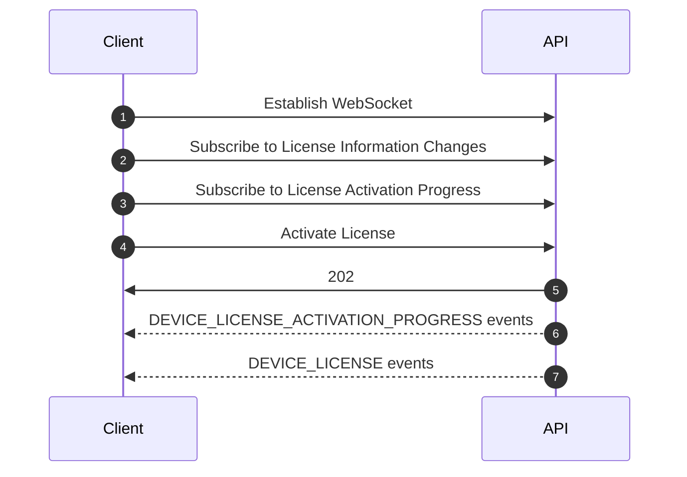
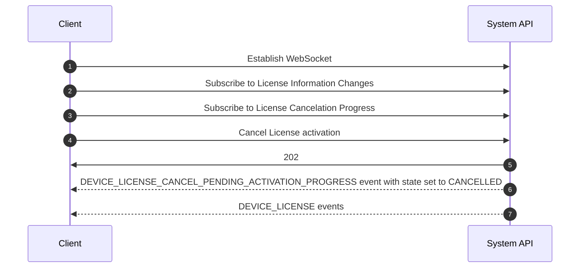
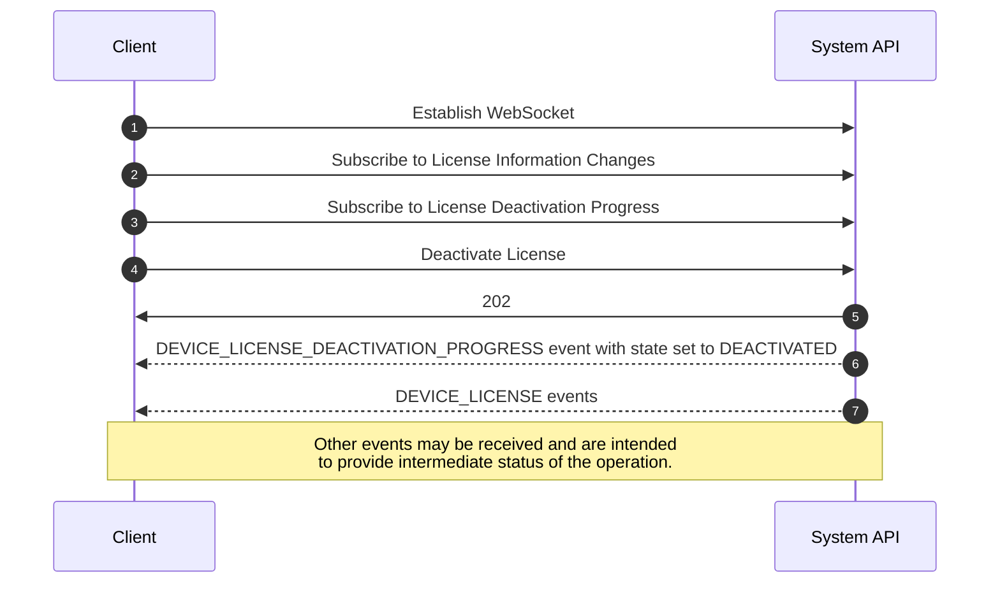

# IntelliMix® Room Licensing Guide

The IntelliMix® Room licensing guide is intended to help users manage the licensing aspects of the [IntelliMix® Room](https://www.shure.com/en-US/products/software/intellimix_room) application using the System API. The IntelliMix® Room application supports two licensing types:

1. A 90-day pre-installed trial license
2. A paid license for long term use

## Endpoint Path Convention
The table below provides a cursory view of the API path prefixes based on the licensing operation being performed.

| License Operation | API URL Path Prefix |
| ---------|----------|
| License Information | `/api/v1/devices/{deviceId}/license` |
| Activate a License  | `/api/v1/devices/{deviceId}/license/activate` | 
| Cancel a Pending Activation | `/api/v1/devices/{deviceId}/license/activate/cancel` | 
| Deactivate a License | `/api/v1/devices/{deviceId}/license/deactivate` | 


<!-- theme: warning -->
> The IntelliMix® Room application requires an internet connection to perform all license operations except for the pre-installed trial.

## License Information

The System API offers operations to retrieve license information from all the configured licenses. See the example below for various licensing configurations

---
<!--
type: tab
title: Paid License Configured
-->
```json lineNumbers
"info": [
  {
    "state": "VALID",
    "activationKey": "V5DZ44D7C7Z6",
    "count": 1,
    "featureName": "IntelliMix.Paid.16",
    "type": "PAID",
    "activationId": "19a0-d2a1-668c-4edc-b966-9674-797b-d3c4",
    "entitlementId": "8bca-63f1-6150-4092-85f0-7e24-9bdf-a815",
    "inUse": true,
    "inGrace": false,
    "inWarning": false,
    "startDate": "2024-01-24T12:00:00Z",
    "expirationDate": "2025-02-12T11:59:00Z",
    "perpetual": false,
    "soldTo": "XYZ Inc."
  }
]
```  

<!--
type: tab
title: Multiple Licenses Configured
-->
```json lineNumbers
"info": [
  {
    "state": "VALID",
    "activationKey": "V5DZ44D7C7Z6",
    "count": 1,
    "featureName": "IntelliMix.Paid.16",
    "type": "PAID",
    "activationId": "19a0-d2a1-668c-4edc-b966-9674-797b-d3c4",
    "entitlementId": "8bca-63f1-6150-4092-85f0-7e24-9bdf-a815",
    "inUse": true,
    "inGrace": false,
    "inWarning": false,
    "startDate": "2024-01-24T12:00:00Z",
    "expirationDate": "2025-02-12T11:59:00Z",
    "perpetual": false,
    "soldTo": "XYZ Inc."
  },
  {
    "state": "VALID",
    "activationKey": "FILE",
    "count": 1,
    "featureName": "IntelliMix.Trial.16",
    "type": "TRIAL",
    "activationId": null,
    "entitlementId": null,
    "inUse": false,
    "inGrace": false,
    "inWarning": false,
    "startDate": "2024-01-24T12:00:00Z",
    "expirationDate": "2024-04-26T11:59:00Z",
    "perpetual": false,
    "soldTo": null
  }
]
```  

<!--
type: tab
title: No Licenses Configured
-->

```json lineNumbers
{
  "info": [] 
}
```
<!-- type: tab-end -->

### License States
The table below provides an explanation of the license information states, their meanings, and whether any action is required from the user.

| License State                  | Paid License                                                                        | Trial License                                                                     |
|-------------------------------|------------------------------------------------------------------------------------|-----------------------------------------------------------------------------------|
| **VALID**                     | License is valid.                                    | License in valid                             |
| **GRACE**                     | License is valid and in the grace period.             | N/A     |
| **TAMPERED**                  | License is tampered and no longer valid.                                                               | License is tampered and no longer valid.                                                                                |
| **CLOCKWINDBACK**             | Clock on this system is changed. Adjust the clock to local time to resolve the issue                                                   | Clock on this system is changed. Adjust the clock to local time to resolve the issue                                                                              |
| **EXPIRED**                   | N/A                                   | Trial license has expired.                           |
| **EXPIRED_PENDING**                   | License is expired and attempting to be refreshed. To stop the continued refresh attempt, the request must be canceled.                                  | N/A                           |
| **ACTIVATION_PENDING_NETWORK** | Activation is pending. A network issue is preventing activation                       | N/A                                                                                |
| **ACTIVATION_PENDING_INSUFFICIENT** | Activation is pending. Insufficent licenses to the user is preventing activation.                                | N/A                                                                                |
| **ACTIVATION_PENDING_OFFLINE** | Activation is pending due to the device being offline.                           | N/A                                                                                |
| **ACTIVATION_FAILED_KEY_ERROR** | Activation is pending due to a invalid key provided in the input. Cancel the current activation request and retry                      | N/A                                                                                |
| **DEACTIVATION_PENDING**      | Deactivation is pending.                                                              | N/A                                                                              |
| **ERROR_INTERNAL**            | An unexpected internal error occurred      | An unexpected internal error occurred    |

**_Note_**: N/A means Not Applicable.


### Remarks

- Always query the license information prior to performing any license related opeations.
- A device's license validity must be determined by `info.state`
- A device's license should be renewed before `info.expirationDate`
- A currently used license from the list of configured licenses can be determined by `info.inUse`

## Activating The License

The System API supports activating a license. A few situations when this is necessary include the following:

- Getting up and running with a device initially
- Unlocking more device features
- Switching from a pre-installed trial license to a paid license, 
- Renewing an expired license (that is in state `EXPIRED`, `EXPIRED PENDING` or `GRACE`)
- Changing the number of licensed audio channels

### Steps

1. Subscribe for license information changes using the API:<br> `POST /api/v1/devices/{deviceId}/license/subscription/{transportId}`
2. Subscribe for license activation progress using the API:<br> `POST /api/v1/devices/{deviceId}/license/activate/subscription/{transportId}`
3. Activate the license using the API:<br> `POST /api/v1/devices/{deviceId}/activate`
  - <!-- theme: info -->
      > - For paid license, a 12-character activation key (E.g. `V5DZ44D7C7Z6`) can be found in your purchase confirmation email, or in your account at [software.shure.com](https://software.shure.com)
      > - For a pre installed trial license, simply use the term `FILE` as the      activation key in your request.
      > - Provide 1 as count when activating a license on IntelliMix® Room
   - `DEVICE_LICENSE_ACTIVATION_PROGRESS` events will provide the information about the license activation progress for the activation.

The above steps are depicted in the following diagram:



You can monitor the status of the operation by observing the event messages received on the WebSocket. There are many events emitted when a license is activated. The following figure gives an example of activating a paid license.


<!--
type: tab
title: License  - Not Configured
-->

```json lineNumbers
{
  "envelope": {
    "eventName": "DEVICE_LICENSE",
    "deviceId": "a497b1db-1bf7-11e9-a000-000eddaaaaaa"
  },
  "body": {
    "info": []
  }
}
```

<!--
type: tab
title: License Activation Progress - Pending
-->

```json lineNumbers
{
  "envelope": {
    "eventName": "DEVICE_LICENSE_ACTIVATION_PROGRESS",
    "deviceId": "a497b1db-1bf7-11e9-a000-000eddaaaaaa"
  },
  "body": {
    "state": "PENDING",
    "count": 1,
    "activationKey": "V5DZ44D7C7Z6",
    "message": "Activation Pending"
  }
}
```

<!--
type: tab
title: License Activation Progress - Activated
-->

```json lineNumbers
{
  "envelope": {
    "eventName": "DEVICE_LICENSE_ACTIVATION_PROGRESS",
    "deviceId": "a497b1db-1bf7-11e9-a000-000eddaaaaaa"
  },
  "body": {
    "state": "ACTIVATED",
    "count": 1,
    "activationKey": "V5DZ44D7C7Z6",
    "message": "Activation Successful"
  }
}
```

<!--
type: tab
title: License - Configured
-->

```json lineNumbers
{
  "envelope": {
    "eventName": "DEVICE_LICENSE",
    "deviceId": "a497b1db-1bf7-11e9-a000-000eddaaaaaa"
  },
  "body": {
    "info": [
      {
        "state": "VALID",
        "activationKey": "V5DZ44D7C7Z6",
        "count": 1,
        "featureName": "IntelliMix.Paid.16",
        "type": "PAID",
        "activationId": "19a0-d2a1-668c-4edc-b966-9674-797b-d3c4",
        "entitlementId": "8bca-63f1-6150-4092-85f0-7e24-9bdf-a815",
        "inUse": true,
        "inGrace": false,
        "inWarning": false,
        "startDate": "2024-01-24T12:00:00Z",
        "expirationDate": "2025-02-12T11:59:00Z",
        "perpetual": false,
        "soldTo": "XYZ Inc."
      }
    ]
  }
}
```
<!-- type: tab-end -->

### Progress States

| License State               | Paid License                                                                      | Trial License                                                                     |
|------------------------|----------------------------------------------------------------------------------|--------------------------------------------------------------------------------|
| **ACTIVATED**          | License is Activated                                                             | License is Activated                                                            |
| **PENDING**             | The device is attempting to activate the license                                  | The device is attempting to activate the license                                 |
| **PENDING_INSUFFICIENT** | Activation is pending. Insufficent licenses on the server is preventing activation.                         | N/A                                                                            |
| **FAILED_INSUFFICIENT** | Activation failed due to insufficient licenses on the device. | Activation failed due to activating an expired trial license |
| **FAILED_INVALID_CONFIGURATION** | Request to activate a license that is invalid for the given device configuration. | Request to activate a license that is invalid for the given device configuration. |
| **ERROR_PARAMETER**     | Activation failed because of a parameter error (ex: asking for a count > 1) | Activation failed because of a parameter error (ex: asking for a count > 1) 
| **PENDING_NETWORK**     | Activation is pending. A network issue is preventing activation                                     | N/A                                                                            |
| **FAILED_NETWORK**      | Activation failed due to a network issue                                | N/A                                                                            |
| **ACTIVATION_CANCELED** | Activation request was canceled                   | N/A                                                                            |
| **FAILED_KEY_NOTFOUND** | Activation key provided is unknown to the license server                         | N/A                                                                            |
| **ERROR_HOST_MISMATCH** | Device was previously licensed to another customer. Uninstall/Reinstall to fix | N/A                                                                            |
| **ERROR_INTERNAL**      | There is an unforeseen internal process error. Reference detail for more information. | There is an unforeseen internal process error. Reference detail for more information. |

**_Note_**: N/A means Not Applicable.
                                                                     
### Remarks

- Users can activate a new paid license on the device while a trial is currently active. However, only one license will be in use at any given time.


## Canceling A Pending Activation License

The System API supports canceling any prior attempt to activate a license which resulted in a pending state. A few situations when this is necessary include the following:

- Attempting to activate more licenses than are available on the license server
- The license server cannot be reached during activation

### Steps

1. Subscribe for license information changes using the API:<br> `POST /api/v1/devices/{deviceId}/license/subscription/{transportId}`
2. Subscribe for cancelating pending progress using the API:<br> `POST /api/v1/devices/{deviceId}/license/activate/cancel/subscription/{transportId}`
3. Cancel the license activation operation using the API:<br> `POST /api/v1/devices/{deviceId}/activate/cancel`
   - `DEVICE_LICENSE_CANCEL_PENDING_ACTIVATION_PROGRESS` event events will provide the information about the license cancelation progress.

The above steps are depicted in the following diagram:



You can monitor the status of the operation by observing the event messages received on the WebSocket. There are many events emitted when a pending license activation is canceled. The following figure gives an example of canceling a pending paid license activation.


<!--
type: tab
title: License Activation Progress - Pending
-->

```json lineNumbers
{
  "envelope": {
    "eventName": "DEVICE_LICENSE_ACTIVATION_PROGRESS",
    "deviceId": "a497b1db-1bf7-11e9-a000-000eddaaaaaa"
  },
  "body": {
    "state": "PENDING_NETWORK",
    "count": 1,
    "activationKey": "V5DZ44D7C7Z6",
    "message": "Activation Pending"
  }
}
```
<!--
type: tab
title: License Cancelation Progress - Pending
-->

```json lineNumbers
{
  "envelope": {
    "eventName": "DEVICE_LICENSE_CANCEL_PENDING_ACTIVATION_PROGRESS",
    "deviceId": "a497b1db-1bf7-11e9-a000-000eddaaaaaa"
  },
  "body": {
    "state": "PENDING",
    "count": 1,
    "activationKey": "V5DZ44D7C7Z6",
    "message": "Pending Cancellation"
  }
}
```

<!--
type: tab
title: License Cancelation Progress - Canceled
-->

```json lineNumbers
{
  "envelope": {
    "eventName": "DEVICE_LICENSE_CANCEL_PENDING_ACTIVATION_PROGRESS",
    "deviceId": "a497b1db-1bf7-11e9-a000-000eddaaaaaa"
  },
  "body": {
    "state": "CANCELED",
    "count": 1,
    "activationKey": "V5DZ44D7C7Z6",
    "message": "Cancelation Successful"
  }
}
```

<!--
type: tab
title: License Activation Progress - Canceled
-->

```json lineNumbers
{
  "envelope": {
    "eventName": "DEVICE_LICENSE_ACTIVATION_PROGRESS",
    "deviceId": "a497b1db-1bf7-11e9-a000-000eddaaaaaa"
  },
  "body": {
    "state": "CANCELED",
    "count": 1,
    "activationKey": "V5DZ44D7C7Z6",
    "message": "Activation Canceled"
  }
}
```

<!-- type: tab-end -->

### Progress States
License State | Paid License | Trial License
---------|----------|---------
**CANCELED** | License is canceled | N/A
**PENDING** | Cancelation is pending | N/A
**FAILED_CANCEL** | If a cancel request is received and there is no pending request or if there is a race condition where the request to cancel if received but before processing the cancel the license becomes active. | N/A
**ERROR_PARAMETER** | Cancel failed because of a parameter error | N/A
**ERROR_INTERNAL** | There is an unforeseen internal process error. Reference detail for more information.	 | N/A


## Deactivating the License

The System API supports deactivating a license. A few situations when this is necessary include the following:

- Attempting to activate a new license
- Performing a factory reset
- Changing the number of licensed audio channels
- Switching from a pre-installed trial license to a paid license

<!-- theme: info -->
> When a paid license is deactivated, it is returned to the license server for future use.

### Steps

1. Subscribe for license information changes using the API:<br> `POST /api/v1/devices/{deviceId}/license/subscription/{transportId}`
2. Subscribe for license deactivation progress changes using the API:<br> `POST /api/v1/devices/{deviceId}/license/deactivate/subscription/{transportId}`
3. Deactivate the license using the API:<br> `POST /api/v1/devices/{deviceId}/deactivate`
   - `DEVICE_LICENSE_DEACTIVATION_PROGRESS` events will provide the information about the license deactivation progress for deactivation.

The above steps are depicted in the following diagram:



You can monitor the status of the operation by observing the event messages received on the WebSocket. There are many events emitted when a license activation is deactivated. The following figure gives an example of deactivating a paid license.

<!--
type: tab
title: License - Configured
-->

```json lineNumbers
{
  "envelope": {
    "eventName": "DEVICE_LICENSE",
    "deviceId": "a497b1db-1bf7-11e9-a000-000eddaaaaaa"
  },
  "body": {
    "info": [
      {
        "state": "VALID",
        "activationKey": "V5DZ44D7C7Z6",
        "count": 1,
        "featureName": "IntelliMix.Paid.16",
        "type": "PAID",
        "activationId": "19a0-d2a1-668c-4edc-b966-9674-797b-d3c4",
        "entitlementId": "8bca-63f1-6150-4092-85f0-7e24-9bdf-a815",
        "inUse": true,
        "inGrace": false,
        "inWarning": false,
        "startDate": "2024-01-24T12:00:00Z",
        "expirationDate": "2025-02-12T11:59:00Z",
        "perpetual": false,
        "soldTo": "XYZ Inc."
      }
    ]
  }
}
```

<!--
type: tab
title: License Deactivation Progress - Pending
-->

```json lineNumbers
{
  "envelope": {
    "eventName": "DEVICE_LICENSE_DEACTIVATION_PROGRESS",
    "deviceId": "a497b1db-1bf7-11e9-a000-000eddaaaaaa"
  },
  "body": {
    "state": "PENDING",
    "count": 1,
    "activationKey": "V5DZ44D7C7Z6",
    "message": "Deactivation Pending"
  }
}
```

<!--
type: tab
title: License Deactivation Progress - Deactivated
-->

```json lineNumbers
{
  "envelope": {
    "eventName": "DEVICE_LICENSE_DEACTIVATION_PROGRESS",
    "deviceId": "a497b1db-1bf7-11e9-a000-000eddaaaaaa"
  },
  "body": {
    "state": "DEACTIVATED",
    "count": 1,
    "activationKey": "V5DZ44D7C7Z6",
    "message": "Deactivation Successful"
  }
}
```

<!--
type: tab
title: License - Not Configured
-->

```json lineNumbers
{
  "envelope": {
    "eventName": "DEVICE_LICENSE",
    "deviceId": "a497b1db-1bf7-11e9-a000-000eddaaaaaa"
  },
  "body": {
    "info": []
  }
}
````

<!-- type: tab-end -->

### Progress States

License State | Paid License | Trial License
---------|----------|---------
**DEACTIVATED** | License is Deactivated | License is Deactivated
**PENDING** | The device is attempting to deactivate the license | The device is attempting to deactivate the license
**ERROR_PARAMETER** | Input data was not valid. Reference detail for more information | Input data was not valid. Reference detail for more information
**FAILED_NETWORK** | Deactivation failed due to a network issue. | N/A
**ERROR_INTERNAL** | There is an unforeseen internal process error. Reference detail for more information.	 | There is an unforeseen internal process error. Reference detail for more information.


## Changing Audio Channel Count

The System API supports changing the audio channel count used by the IntelliMix® Room application. To change the audio channel count and to monitor the outcome, multiple APIs must be called as described in the sequence below:

1. Deactivate any valid and currently in use licenses using the steps mentioned in [Deactivating The License](#deactivating-the-license)
2. Subscribe for audio channel count changes using the API:<br>  `POST  /api/v1/devices/{deviceId}/audio-channel-count/subscription/{transportId}`
3. Update the audio channel count using the API:<br> `POST /api/v1/devices/{deviceId}/audio-channel-count`<br> and wait for a `DEVICE_AUDIO_CHANNEL_COUNT` event with the new count value before proceeding.
4. Activate the license using the steps mentioned in [Activating The License](#activating-the-license)
